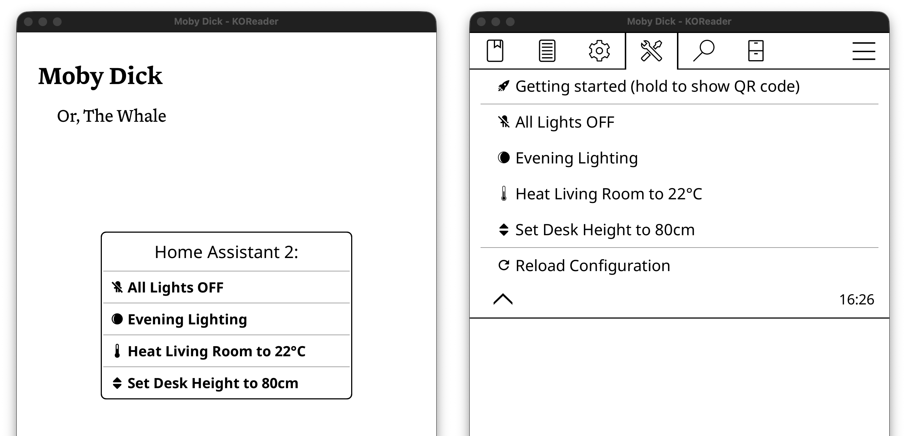

# Home Assistant 2

<p align="center">

  <i></i>
</p>

A KOReader plugin that executes Home Assistant actions from a menu or via a gesture. This is an experimental project.

If you are currently using `homeassistant.koplugin` (V1), read [Why `homeassistant2.koplugin`?](#why-homeassistant2koplugin).

## Installation

1. Download the latest release of the plugin and unzip it.
2. Copy the `homeassistant2.koplugin` folder to `koreader/plugins/` on your e-reader.
3. Restart KOReader. A sample configuration file is created at `koreader/settings/homeassistant2_config.lua`.

## Configuration

Create a long-lived access token in Home Assistant (Profile → Security), then edit `homeassistant2_config.lua`:

```lua
return {
    settings = {
        url = "http://192.168.1.20:8123",
        token = "YOUR_LONG_LIVED_ACCESS_TOKEN",
        show_getting_started = true,
    },

    user_actions = {
        -- see below
    },
}
```

## User actions

Add actions to the `user_actions` list. Each action is a table containing three fields:

- `label`: the name displayed in the menu and gesture list.
- `action`: the Home Assistant action in `domain.action` form, such as `light.turn_on`, `switch.turn_off` or `fan.toggle`.
- `action_data`: holds the targets (entity_id, device_id, area_id, label_id), each a string or a list. Targets can be combined. Any additional fields that the called action supports, such as `brightness_pct`, `color_name` or `temperature`, can be included as well.

Examples:

```lua
    user_actions = {
        -- 1. One action, one entity
        {
            label = "Desk Lamp Off",
            action = "light.turn_off",
            action_data = { entity_id = "light.desk_lamp" },
        },
        -- 2. Target a whole area, with extra data
        {
            label = "Reading Light",
            action = "light.turn_on",
            action_data = {
                area_id = "living_room",
                color_name = "warm_white",
                brightness_pct = 80,
            },
        },
        -- 3. Combined targets, with extra data
        {
            label = "Cozy Heating",
            action = "climate.set_temperature",
            action_data = {
                entity_id = { "climate.living_room", "climate.hallway" },
                label_id = "heating",
                temperature = 21.5,
            },
        },
        -- 4. Advanced: nested data
        {
            label = "Notify Devices from KOReader",
            action = "notify.notify",
            action_data = {
                title = "From my e-reader",
                message = "Finished the chapter!",
                data = {
                    push = { sound = "none" },
                    notification_icon = "mdi:book-open-variant",
                    color = "#4caf50",
                    priority = "high",
                },
            },
        },
    },
```

## Using the plugin

- **Menu:** Tools → Home Assistant 2 → pick an action.
- **Gestures:** Assign Home Assistant 2 actions (under **General**) to open a list of all configured actions, or bind an individual action directly by its label.
- After editing the configuration, choose **Reload Configuration** at the bottom of the menu.

## Why `homeassistant2.koplugin`?

This is a rewrite of [homeassistant.koplugin](https://github.com/moritz-john/homeassistant.koplugin) (V1). If V1 already does what you need, there's no reason to switch.

V1 mirrors Home Assistant's YAML action syntax (`action`, `target`, `data`). HA2 instead maps directly to the Home Assistant REST API: `action_data` is a Lua table that corresponds 1:1 to the [JSON request body](https://developers.home-assistant.io/docs/api/rest/#post-apiservicesdomainservice).

HA2 also validates the configuration when loading and, if something is wrong, shows the error in the menu. Changes take effect through **Reload Configuration**, without restarting KOReader.

HA2 is deliberately focused on triggering actions and does not read data back from Home Assistant. If you want to display entity states, attributes or templates on your e-reader, V1 is the better fit.

The two plugins use separate config files and can be installed side by side, but the configs are not compatible.

<p align="center">

</p>